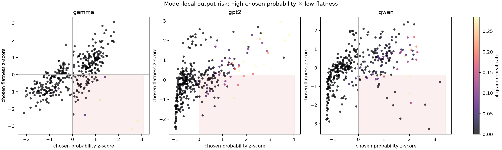

# model-local risk coordinate figure

赤く薄く示した右下領域は、chosen probabilityがモデル平均より高く、chosen flatnessが低い領域である。前回の分類器で反復リスクと共通して関連した2軸を表示した。

## quadrant summary

| model   | risk_quadrant          |   n |   repeat_rate |   mean_repeat |
|:--------|:-----------------------|----:|--------------:|--------------:|
| gemma   | high_prob_low_flatness |  53 |    0.150943   |   0.0889045   |
| gemma   | other                  | 307 |    0.00651466 |   0.000788853 |
| gpt2    | high_prob_low_flatness |  36 |    0.222222   |   0.0348015   |
| gpt2    | other                  | 324 |    0.104938   |   0.027985    |
| qwen    | high_prob_low_flatness |  42 |    0.238095   |   0.0524045   |
| qwen    | other                  | 318 |    0.0786164  |   0.0118123   |

この図は相関を示すもので、制御閾値の確定には独立prompt・seedでの再検証が必要である。
